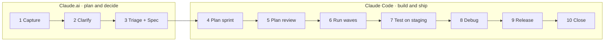

<div align="center">


# Bandit Brain Marketplace

**Claude skills, agents and hooks that run your task board, your notes vault and your delivery pipeline: from an idea in the inbox to a tagged release.**

[](CHANGELOG.md)
[](https://github.com/l3ocho/bandit-brain-marketplace/actions/workflows/check.yml)
[](LICENSE)
[](#-install)
[](#-install)

[Install](#-install) · [Plugins](#-the-three-plugins) · [Pipeline](#-the-delivery-pipeline) · [Docs](#-documentation) · [Changelog](CHANGELOG.md)

</div>

---

## 🦝 What it is

**Bandit Brain** is a self-hosted task board with an MCP server. This marketplace, `bandit-brain`, teaches Claude to work it the way a disciplined team would, on **Claude.ai** (web, desktop and phone) and in **Claude Code**:

- 📥 **Capture and triage**: brain dumps become cards; every card leaves the inbox with its fields answered and its date set last
- 🗺️ **Domain-aware**: each project works its own board first, reads and writes across its domain, and never sees anything outside it
- 🗂️ **Notes that file themselves**: one set of vault conventions (Obsidian over WebDAV), meeting minutes from a recording, clean rewrites of messy text
- 🧭 **From idea to plan**: clarify a fuzzy idea, write a project plan and architecture, break it into a gap-checked WBS
- 🏃 **A sprint pipeline with gates**: plan in waves, an independent plan review, one subagent per wave, test, debug, release on your word
- 🧱 **Rules as code**: structure audits are scored by a script, sprints by a checker, and this repo by its own gate

## 🧩 The three plugins

| Plugin | For | Contents | Runs on |
|---|---|---|---|
| **`bandit`** | Everyone | 8 skills: `tasks` · `notes` · `project` · `audit` · `clarify` · `rewrite` · `plan` · `minutes` | Claude.ai + Claude Code |
| **`bandit-dev`** | Developers | Skills `sprint` and `testdata` · agent `plan-reviewer` · sprint-checker Stop hook. Needs `bandit` | Claude Code |
| **`bandit-maker`** | Maintainers | Skill `skill`: create, evaluate and lint skills to the house standard | Claude Code |

Every skill is called by plugin and area, with the verb as argument:

```
/bandit:tasks today          /bandit:notes file           /bandit:plan wbs
/bandit:tasks triage         /bandit:project audit        /bandit-dev:sprint plan
```

Plain words work too ("what's on my board today?"). On the mobile apps the `/` menu doesn't list skills yet, but typed commands run. Every command, with its modifiers and example workflows: **[the cheat sheet](docs/cheat-sheet.md)**.

## 🚀 Install

**Claude.ai** (web, desktop, mobile): Customize → Plugins → **Add → Add marketplace** → `l3ocho/bandit-brain-marketplace` → install **`bandit`**. Plugins on your account also reach Claude Code (as `bandit@synced`).

**Claude Code**:

```
/plugin marketplace add l3ocho/bandit-brain-marketplace
/plugin install bandit@bandit-brain
/plugin install bandit-dev@bandit-brain       # developers
/plugin install bandit-maker@bandit-brain     # maintainers
```

Then `/plugin` → Marketplaces → `bandit-brain` → **Enable auto-update** (off by default for marketplaces outside Anthropic's).

**Updating:** on a claude.ai account, a new release arrives only through the **Claude desktop app**: **Chat** tab → Customize → Plugins → **Manage marketplaces** → ⋮ → **Check for updates**. The web app has no update control, the Code tab's check fails, and automatic sync doesn't fire on push (Anthropic issues [#86818](https://github.com/anthropics/claude-code/issues/86818), [#93825](https://github.com/anthropics/claude-code/issues/93825)). Details: [install, section 4](docs/install.md#4-update).

### Requirements

| Connector | Used by | Needed |
|---|---|---|
| **Bandit Brain** MCP server (the task board) | `tasks`, `audit`, `project`, `sprint` | ✅ |
| **Nextcloud** MCP server with WebDAV (the notes vault) | `notes`, `minutes`, `plan`, `project`, `audit`, `sprint` | ✅ |
| Gmail | `/bandit:tasks email` | Optional |
| Code execution (Claude.ai: Settings → Capabilities) | Every skill on Claude.ai | ✅ |

Each project tells the skills where it lives with a short **Project Context** block in its instructions (or its repo's `CLAUDE.md`); `/bandit:project onboard` writes it. Full steps, including first-time setup: **[docs/install.md](docs/install.md)**.

## 🔄 The delivery pipeline



Every stage has an owner command, a record and a gate that fails when it's skipped. A project supplies its own recipe (verify, branches, migrations, staging, release) in a `bandit.yaml` at its repo root. Details: **[docs/pipeline.md](docs/pipeline.md)** · **[docs/bandit-yaml.md](docs/bandit-yaml.md)**.

## 📚 Documentation

| Doc | Read it for |
|---|---|
| [Cheat sheet](docs/cheat-sheet.md) | Every command, mode and modifier, grouped by skill, plus full-review prompts |
| [Install](docs/install.md) | Installing, updating and first-time setup on each surface |
| [Pipeline](docs/pipeline.md) | The ten stages from idea to closed release: surface, command, record, gate |
| [`bandit.yaml` contract](docs/bandit-yaml.md) | The recipe a dev project supplies to the sprint skills |
| [Decisions](docs/decisions.md) | Why things are the way they are: architecture, rules, guards |
| [Changelog](CHANGELOG.md) · [Releases](https://github.com/l3ocho/bandit-brain-marketplace/releases) | What changed in each release |
| [Instruction templates](templates/instructions/) | The one-page project instructions per project type |
| [Test cases](tests/cases.md) | One case per behaviour, input → expected result |
| [Contributing](CONTRIBUTING.md) | How to propose and make a change |
| [Contributor guide](CLAUDE.md) | Layout, rules, the gate and branches for working on this repo |
| [Security](SECURITY.md) | How to report a problem privately |

## 🏷️ Versioning

The three plugins and the marketplace share one version and follow [Semantic Versioning](https://semver.org): **major** when a command, mode or skill is removed or renamed or the Project Context format changes, **minor** for new commands or behaviour, **patch** for fixes. `scripts/release.py X.Y.Z` cuts a release: it dates the [changelog](CHANGELOG.md) entry, bumps every version and tags `vX.Y.Z` on `main`, and each tag is published as a [GitHub release](https://github.com/l3ocho/bandit-brain-marketplace/releases). The gate refuses a released version without its tag. Installed copies don't update on their own yet: see **Updating** under [Install](#-install).

## 🔧 Develop

```
python3 scripts/check_repo.py                              # the gate (pre-commit hook and CI)
claude plugin validate plugins/<plugin>                    # one plugin
python3 plugins/bandit-maker/skills/skill/scripts/house_lint.py plugins/bandit/skills/*
```

Work happens on `development`; `main` moves only at a release. Every skill stays light: a description of at most 300 characters and a `SKILL.md` of at most 150 lines, because every installed skill loads into every chat. A new kind of mistake becomes a checker rule, not a new sentence. The full rules are in the [contributor guide](CLAUDE.md) and [decisions](docs/decisions.md); start with [CONTRIBUTING](CONTRIBUTING.md).

## 📄 License

[MIT](LICENSE). `plugins/bandit-maker/skills/skill/` keeps its upstream Apache 2.0 [`LICENSE.txt`](plugins/bandit-maker/skills/skill/LICENSE.txt).

<div align="center">
<sub>Made by <a href="https://banditlabs.ca">Bandit Labs</a> 🦝</sub>
</div>
